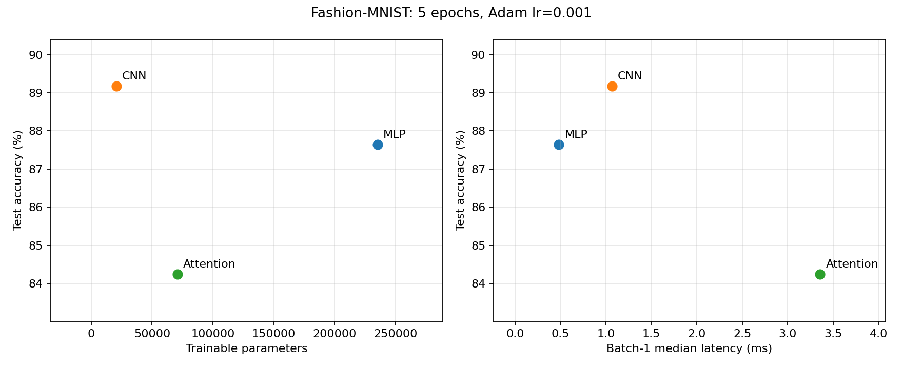
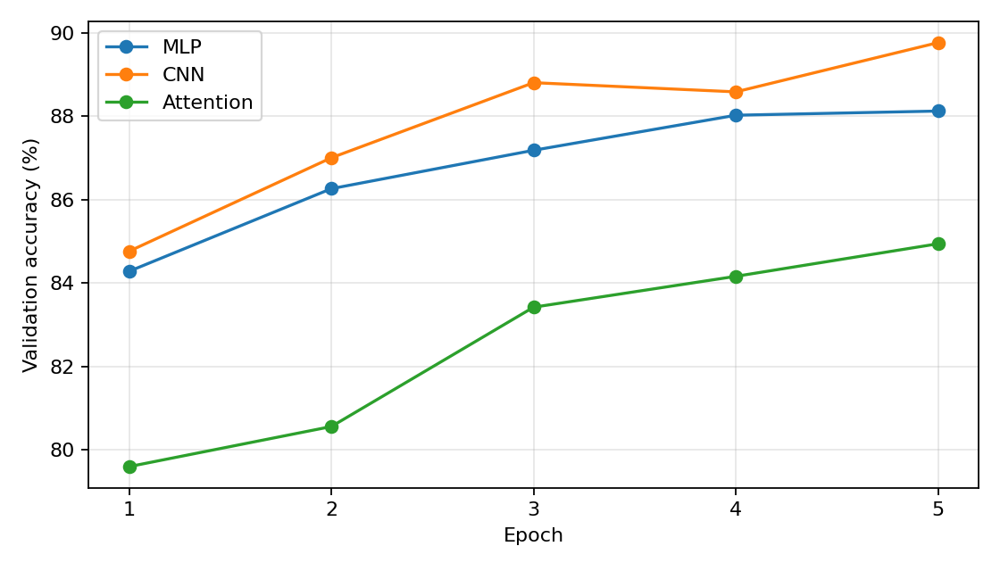

# Lab 03 - Architectures and their costs

## 1. Goal

Compare the prescribed MLP, CNN and patch-attention classifiers on Fashion-MNIST using test accuracy, parameter storage, arithmetic cost and inference latency.

## 2. Method

All experiment code and saved outputs are in [architectures.ipynb](architectures.ipynb). The dataset is downloaded into the ignored repository-level `data/` directory. The official 60,000 training images are split deterministically into 55,000 training and 5,000 validation images; the official 10,000 test images remain separate. Inputs use ToTensor and normalization with mean 0.2860 and standard deviation 0.3530. Each model is trained for five epochs with Adam, learning rate 0.001 and batch size 128. Initialization, data splitting and loader generators use seed 42; Python, NumPy and CPU/CUDA Torch seeds are set.

The final epoch-five model is evaluated on the test set; validation metrics are logged without choosing checkpoints from test performance. The models share training examples, epoch count, optimizer settings and batch order. The comparison does not control for equal parameter count or equal compute.

### Architecture and parameter calculations

- MLP: Flatten -> Linear(784,256) -> ReLU -> Linear(256,128) -> ReLU -> Linear(128,10). Parameters: (784+1)×256 + (256+1)×128 + (128+1)×10 = **235,146**.
- CNN: Conv(1,16,3,pad=1) -> ReLU -> Pool(2) -> Conv(16,32,3,pad=1) -> ReLU -> Pool(2) -> Flatten -> Linear(1568,10). Parameters: (9+1)×16 + (9×16+1)×32 + (1568+1)×10 = **20,490**.
- Attention: sixteen 7×7 patches -> Linear(49,64) -> two encoder layers (d=64, four heads, feedforward width 128) -> mean pool -> Linear(64,10). Each encoder has 16,640 attention parameters, 16,576 feedforward parameters and 256 normalization parameters. Total: 3,200 + 2×33,472 + 650 = **70,794**. PyTorch defaults provide ReLU, dropout 0.1 and LayerNorm. No extra class token or positional embedding is introduced.

The assignment's target of 100k–150k parameters conflicts with its exact layer specifications: none of these prescribed models falls in that range. The exact architectures are retained. Counts are checked against both torchinfo.summary and the sum of parameter tensor sizes; full summaries are saved in `results/model_summaries.txt`.

### Hand-calculated arithmetic cost

Count one multiply-add as two FLOPs. These estimates cover matrix products and convolution, excluding bias additions, activations, pooling, normalization, softmax and residual additions.

For a linear layer, FLOPs = 2×input×output. MLP's first layer costs 2×784×256 = **401,408**; the full MLP costs **469,504 FLOPs/image**.

For a convolution, FLOPs = 2×K²×Cin×Cout×Hout×Wout. CNN's first convolution costs 2×3²×1×16×28² = **225,792**; its second costs **1,806,336**. The final linear layer adds **31,360**, giving **2,063,488 FLOPs/image**.

For attention with S=16 and d=64, QKV projections cost 2×S×d×3d = **393,216 FLOPs**. QK^T and multiplication by V each cost **32,768**, and output projection costs **131,072**. The feedforward layers add **524,288**, giving **1,114,112 per encoder layer**. Two layers plus patch projection (**100,352**) and classification (**1,280**) total **2,329,856 FLOPs/image**.

### Profiling and latency protocol

THOP's default profile is reported alongside a profile with a custom MultiheadAttention hook. The hook counts QKV projection, attention scores, weighted values and output projection; THOP's existing hooks count the other layers. THOP generally reports MACs. Doubling its total is the comparison convention, but normalization hooks estimate scalar operations rather than pure MACs, so this conversion is not an exact whole-model FLOP count. In this installed THOP version, four LayerNorm modules contribute 4×16×64×4 = 16,384 raw counter units; doubling them explains the 32,768-operation gap between the supported attention profile and the hand matrix-product total. Softmax, residual addition and other unhooked functional operations are still omitted.

Latency measures inference on prepared device tensors, excluding data loading and host-to-device copies. Every model is in eval and inference mode. After one warm-up, batch 1 uses the median of 100 runs and batch 128 the median of 20. CUDA is synchronized around timed calls when available. The executed run uses CPU with two Torch threads and disables the fused MHA inference path so hooks can observe the explicit operations. These settings apply to all models; results are not representative of every optimized deployment backend. Actual package versions and hardware information are in `results/versions.txt`. The existing course environment uses Python 3.11.8 and the previously documented PyArrow 15.0.2 exception.

## 3. Results

All values below are measured in the completed notebook run. Full numerical results are in [measurements.csv](results/measurements.csv).

| Model | Parameters | Test accuracy | Batch 1 median (ms) | Batch 128 median (ms) | Batch 128 ms/image |
|---|---:|---:|---:|---:|---:|
| MLP | 235,146 | 87.64% | 0.4825 | 2.8332 | 0.022134 |
| CNN | 20,490 | 89.17% | 1.0663 | 38.0417 | 0.297200 |
| Attention | 70,794 | 84.24% | 3.3568 | 26.1463 | 0.204268 |

Batch 1 uses 100 timed repetitions; batch 128 uses 20. Both follow a warm-up. These are medians of batch execution times, excluding input loading.

| Model | Hand matrix-product FLOPs | 2 x default THOP | 2 x THOP with attention hook |
|---|---:|---:|---:|
| MLP | 469,504 | 469,504 | 469,504 |
| CNN | 2,063,488 | 2,063,488 | 2,063,488 |
| Attention | 2,329,856 | 1,182,976 | 2,362,624 |

The MLP and CNN estimates match exactly under this counting convention. Default THOP omits the attention module products. The supported attention estimate exceeds the hand product-only count by 32,768 because its LayerNorm hooks are also counted, as explained above.

### Access patterns and practical choice

The MLP uses dense, sequential weight access. A batch reuses the same weights for many inputs, improving arithmetic intensity; it has the smallest arithmetic count and the lowest latency here, despite storing the most parameters.

The CNN uses local sliding windows and shared filters. Its 20,490 parameters are approximately 11.48 times fewer than the MLP, while test accuracy is 1.53 percentage points higher. However, reusing those filters at many spatial positions increases arithmetic work: the smaller model is not automatically the fastest. It is the strongest measured choice for accuracy with a small parameter footprint.

Attention uses tiled QKV projections and pairwise score/value products, followed by reductions and normalization. Its 16-token sequence limits quadratic cost, but repeated small operations create overhead. It is less accurate and slower than CNN at batch 1, though its batch-128 latency is lower than CNN on this CPU. Thus the ranking changes with batching and kernel behavior; FLOPs alone do not determine wall-clock latency.

For interactive batch-1 latency, MLP is the best measured option. For accuracy and parameter storage, CNN is the best measured option. Attention does not offer a competitive accuracy/latency trade-off for individual images in this five-epoch, position-free configuration.

## 4. Conclusions

1. CNN achieved the highest test accuracy (89.17%) with the fewest parameters (20,490). Its spatial locality and shared filters were useful for this image task, although its arithmetic work exceeded MLP's.
2. MLP gave the lowest measured inference latency (0.4825 ms for batch 1; 2.8332 ms for batch 128) at 87.64% accuracy. Parameter count alone was a poor predictor of runtime.
3. Attention reached 84.24% after five epochs. Profiling required an attention-specific counter, and operation counts did not fully explain latency: normalization, small kernels and batch size also mattered.

## 5. Sources and limitations

Assignment: Lab Manual: Labs 03, “Architectures and their costs.” Reading: Vijay Janapa Reddi, Introduction to Machine Learning Systems, supplied ML.pdf edition, Chapter 6: sections 6.2 (MLPs), 6.3 (CNNs), 6.5 (Attention), 6.8 (Shared Building Blocks) and 6.9 (Computational Primitives). The manual's Chapter 4 references correspond to a different textbook edition. Table 6.10 of the supplied edition contrasts sequential dense access, strided sliding-window reuse and tiled QKV / gather-reduce access patterns.

Only one fixed-seed training run per model and five epochs are used. Test-set comparisons are descriptive, not statistically established rankings. Batch-128 amortized per-image latency is distinct from the response time of a single independent request. No positional embeddings are specified for the attention model: after mean pooling it is invariant to whole-patch permutations, limiting spatial information. No training-time or end-to-end data-pipeline speed claim is based on the inference measurements. Per-epoch losses and accuracies are recorded in [training_history.csv](results/training_history.csv).
