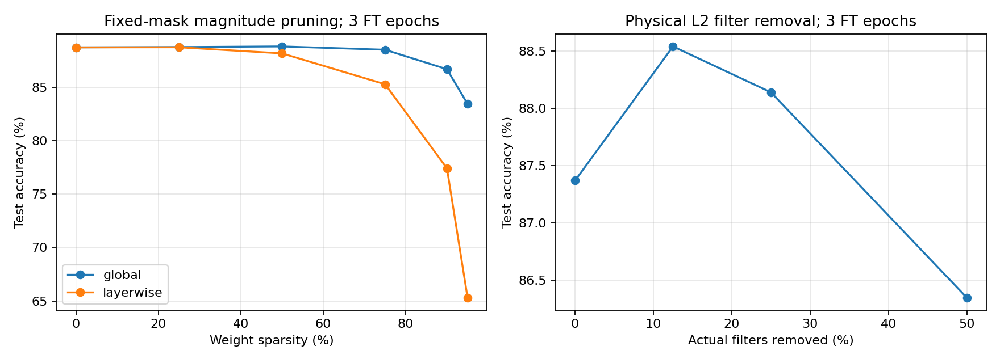
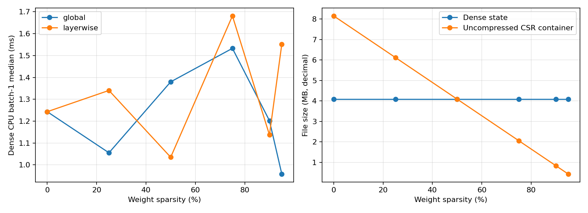

# Lab 07: Pruning and distillation

## 1. Baseline CNN

The aim of this lab was to make a CNN smaller and compare what happens to its accuracy, file size and prediction time.

I used Fashion-MNIST with 55,000 training images, 5,000 validation images and the official 10,000 test images. All models used the same split and normalization. The seed was 42.

The baseline CNN has two convolutional layers with 8 and 16 filters, followed by pooling and a 784-1280-10 classifier. It has **1,018,858 parameters**, which is close to the required one million. I trained it for five epochs using Adam, a learning rate of 0.001 and batch size 512. The experiments ran on CPU with two PyTorch threads.

The final model reached **87.37% test accuracy**. Its dense file was **4.078 MB**, and its measured prediction time for one image was **2.0844 ms**.

## 2. Pruning

First, I removed weights with the smallest absolute values. I tested 0%, 25%, 50%, 75%, 90% and 95% sparsity in two ways:

- **Global:** choose the smallest weights across the whole model.
- **Layer-wise:** remove the same percentage of weights from each layer.

Biases were kept. Every variant started from the original baseline and was fine-tuned for three epochs with Adam at learning rate 0.0001. A fixed mask kept the removed weights at zero throughout training.

I also fine-tuned a model with no weights removed. It reached **88.72%**, compared with the original **87.37%**. This matters because some improvement can come from the extra training itself. The global and layer-wise 0% cases are identical, so they share this control run.

Next, I tried removing whole convolutional filters. I ranked filters by their L2 norm and removed those with the smallest norms. I also adjusted the following layers so that the resulting network was physically smaller. The requested levels were 10%, 25% and 50%; rounding to whole filters gave 12.5%, 25% and 50%. Each model was then fine-tuned for three epochs.

Global pruning kept accuracy fairly close to the control through 75% sparsity. At higher sparsity, layer-wise pruning lost more accuracy because it also removed a large share of the convolutional weights. In the structured plot, the 0% point is the original baseline; the other points include fine-tuning.

## 3. File size and prediction time

I saved each model in a normal dense format and in an uncompressed CSR format. CSR stores nonzero weights and their positions. I checked that loading the CSR arrays restored exactly the same weights.

For the baseline, the dense file was **4.078 MB**, while CSR took **8.157 MB**. CSR was larger because storing positions adds overhead. At 95% global sparsity, CSR fell to **0.424 MB**, while the dense file stayed at **4.078 MB**.

A smaller sparse file does not automatically make prediction faster. The pruned models still ran through normal dense PyTorch operations, which process the full tensors, including zeros. Removing whole filters really changes tensor sizes and reduces the required calculations.

I measured prediction time after warm-up, without data loading or file conversion. Each round used 100 calls for batch 1 and 20 for batch 128, after 20 and 5 warm-up calls respectively. I repeated this in three rounds with shuffled model order and used the median of the round medians.

Timings varied noticeably between rounds. Even the two students, which have the same architecture, had different measured times. These results should therefore be read as measurements from this computer, rather than proof that one weight pattern is faster. All rounds are saved in `latency_repetitions.csv`.

## 4. Knowledge distillation

The student uses the same convolutional layers but reduces the hidden classifier from 1280 units to 128. This gives **103,018 parameters**. I trained it once using only the correct labels and once using both the labels and the teacher's predictions.

Both students started with the same weights and used the same batches, Adam settings and five training epochs. The teacher was frozen. Following the manual, I used T=4, alpha=0.5 and this loss:

`0.5 * CE(student, labels) + 0.5 * T^2 * KL(student probabilities || teacher probabilities)`

The probabilities in the KL term use logits divided by T. The KL direction is student-to-teacher, as written in the manual.

The plain student reached **85.61%**, and the distilled student reached **85.77%**. Distillation improved accuracy by **0.16 percentage points** in this run. The improvement was small, and training took extra work because it also needed the teacher's forward pass.

## 5. Overall comparison

The table brings together the four efficiency pillars:

- **Data:** every model used the same 55,000 training and 10,000 test images, plus 5,000 validation images.
- **Model:** parameter count, nonzero weights and saved file sizes.
- **Compute:** FLOPs and measured prediction time.
- **Energy:** CPU time as a rough activity indicator. I could not measure energy in Joules. CPU time is not an energy reading and cannot prove energy savings.

MB means 1,000,000 bytes. FLOPs count multiplication and addition separately and exclude biases, activations and pooling. Zero weights do not reduce the dense FLOP count. CPU time includes work across threads and can be higher than elapsed time.

| Model | Train/test images | Accuracy % | Parameters | Nonzero weights | Dense MB | CSR MB | MFLOPs | Time/image ms | CPU ms/image* |
|---|---|---:|---:|---:|---:|---:|---:|---:|---:|
| Teacher | 55000/10000 | 87.37 | 1,018,858 | 1,017,544 | 4.078 | 8.157 | 2.597 | 2.0844 | 3.5938 |
| Global 0% | 55000/10000 | 88.72 | 1,018,858 | 1,017,544 | 4.078 | 8.157 | 2.597 | 1.2431 | 3.2812 |
| Global 25% | 55000/10000 | 88.75 | 1,018,858 | 763,158 | 4.078 | 6.122 | 2.597 | 1.0551 | 2.8125 |
| Global 50% | 55000/10000 | 88.81 | 1,018,858 | 508,772 | 4.078 | 4.087 | 2.597 | 1.3797 | 3.1250 |
| Global 75% | 55000/10000 | 88.50 | 1,018,858 | 254,386 | 4.078 | 2.052 | 2.597 | 1.5328 | 2.0312 |
| Global 90% | 55000/10000 | 86.68 | 1,018,858 | 101,754 | 4.078 | 0.831 | 2.597 | 1.2021 | 2.9688 |
| Global 95% | 55000/10000 | 83.43 | 1,018,858 | 50,877 | 4.078 | 0.424 | 2.597 | 0.9579 | 2.3438 |
| Layerwise 0% | 55000/10000 | 88.72 | 1,018,858 | 1,017,544 | 4.078 | 8.157 | 2.597 | 1.2431 | 3.2812 |
| Layerwise 25% | 55000/10000 | 88.73 | 1,018,858 | 763,158 | 4.078 | 6.122 | 2.597 | 1.3403 | 2.9688 |
| Layerwise 50% | 55000/10000 | 88.16 | 1,018,858 | 508,772 | 4.078 | 4.087 | 2.597 | 1.0349 | 2.5000 |
| Layerwise 75% | 55000/10000 | 85.27 | 1,018,858 | 254,386 | 4.078 | 2.052 | 2.597 | 1.6812 | 2.9688 |
| Layerwise 90% | 55000/10000 | 77.41 | 1,018,858 | 101,754 | 4.078 | 0.831 | 2.597 | 1.1368 | 2.6562 |
| Layerwise 95% | 55000/10000 | 65.32 | 1,018,858 | 50,878 | 4.078 | 0.424 | 2.597 | 1.5521 | 3.7500 |
| Structured 10% | 55000/10000 | 88.54 | 893,136 | 891,825 | 3.576 | 7.151 | 2.226 | 1.0405 | 2.6562 |
| Structured 25% | 55000/10000 | 88.14 | 767,450 | 766,142 | 3.073 | 6.146 | 1.870 | 0.7811 | 2.0312 |
| Structured 50% | 55000/10000 | 86.35 | 516,186 | 514,884 | 2.068 | 4.135 | 1.198 | 0.5504 | 1.4062 |
| Plain student | 55000/10000 | 85.61 | 103,018 | 102,856 | 0.415 | 0.830 | 0.768 | 0.7335 | 1.8750 |
| Distilled student | 55000/10000 | 85.77 | 103,018 | 102,856 | 0.415 | 0.830 | 0.768 | 1.3083 | 2.0312 |

*CPU time is only an activity indicator, not measured energy. The two 0% pruning rows share one control run. Training times in the result files include validation; pruning times cover the three extra epochs only.

### Conclusion

The highest accuracy was **88.81%**, from **Global 50%**. Global pruning preserved accuracy better than layer-wise pruning at high sparsity. Sparse storage helped once enough weights were zero, but it did not reduce the work done by dense kernels.

The student used about **9.9 times fewer parameters** than the teacher. Distillation gave it a small accuracy improvement of **0.16 percentage points**. Removing filters and using a smaller network reduced the actual dense computation, while prediction times still needed careful measurement.

These are single-seed results. Timing variation was large enough that small speed differences are not reliable. Energy savings cannot be confirmed without power measurements.

## Sources

Lab Manual: Labs 07, Compression: pruning and distillation; Reddi, Chapters 9 and 10, sections 10.3-10.4. Fashion-MNIST: https://github.com/zalandoresearch/fashion-mnist. Data and model details are in `data_card.md` and `model_card.md`.
